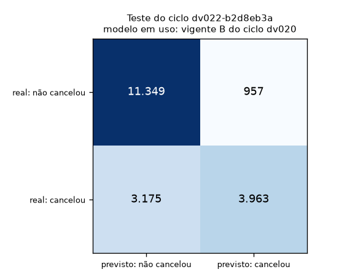
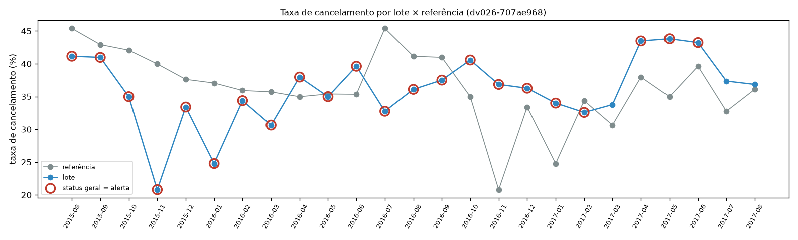

# Pipeline MLOps para previsão de cancelamento de reservas

**Trabalho N3 · Análise Preditiva** · Católica de Santa Catarina · Prof. Rodrigo Hagstrom · novembro de 2026

Repositório: [github.com/GabrielKaring/projeto-n3-mlops-hotel](https://github.com/GabrielKaring/projeto-n3-mlops-hotel)

## Integrantes e divisão

Cada critério do enunciado virou uma feature com dono (`config/equipe.yaml`). O `HISTORICO_DESENVOLVIMENTO.md`, gerado a partir do git, mostra o que cada um fez.

| Feature | Critério | Dono |
|---|---|---|
| F1 a F4 | Problema e dados, ETL, três métodos de seleção, votação | Gabriel Karing |
| F5 | Dois algoritmos disputam | Gabriel Wendorff |
| F6 | MLflow e rastreabilidade | José |
| F7 e F8 | Workflow e agendamento; eleição, promoção e previsões | Diego |
| F9 | Repositório, relatório e evidências | Vinicius |
| F10 | Recurso adicional: drift com alerta | Lucas e Guilherme |

## 1. Problema, dados e avaliação

O objetivo é prever, no momento da reserva, se ela vai ser cancelada. Com isso o hotel consegue controlar overbooking, pedir depósito nas reservas de risco e planejar a ocupação.

**Quem usaria:** a gestão de receita e de reservas do hotel. Para cada reserva que entra, ela recebe a probabilidade de cancelamento e decide quanto overbooking aceitar em cada data, quais reservas exigem depósito ou confirmação e qual ocupação esperar de fato. A equipe de dados acompanha os ciclos no MLflow e o alerta de drift.

Usamos o *Hotel Booking Demand* (Antonio, Almeida & Nunes, 2019, *Data in Brief*, licença CC BY): 119.390 reservas de dois hotéis em Portugal, com chegadas de jul/2015 a ago/2017. O alvo é `is_canceled`, com 37% de positivos.

- **Métrica principal: F1 macro.** Com 63% contra 37%, a acurácia premiaria um modelo que ignora o cancelamento. O F1 macro pesa as duas classes igual. Acompanhamos também ROC-AUC, PR-AUC, acurácia balanceada, recall e precisão do cancelamento.
- **Partição cronológica.** O teste é formado pelos últimos 20% de cada ciclo por data de chegada e só é usado na promoção. No desenvolvimento, a seleção de features e a competição usam `TimeSeriesSplit` com 4 folds.
- **Sem vazamento.** Tudo o que aprende com os dados (limites de outlier, escala, categorias) fica dentro do Pipeline e é ajustado só no treino. Há teste automático para isso.
- **Colunas descartadas** por só existirem depois da reserva: `reservation_status`, `assigned_room_type`, `booking_changes` e `country` (o próprio artigo do dataset avisa que a nacionalidade costuma ser corrigida no check-in).

Todas essas decisões foram fixadas antes de treinar qualquer modelo e estão em `docs/etapa1_problema_dados_avaliacao.md` e `config/config.yaml`.

## 2. ETL e chegada de dados novos

Os dados foram quebrados em lotes mensais. O ciclo inicial tem 18 lotes (jul/2015 a dez/2016), e os 8 de 2017 ficam em `data/incoming/` para simular dados chegando. Cada execução libera um lote novo.

- `data/raw/manifest.json` guarda o `sha256`, as linhas e o período de cada lote. Um lote repetido é ignorado; um lote alterado derruba o pipeline.
- `data_version = dvNNN-<hash>` identifica o conjunto de dados, e o `cycle_id` identifica a execução. Os dois acompanham o ciclo do começo ao fim.
- **Duplicatas:** 29% das linhas iniciais são idênticas a outra, e a taxa de cancelamento nelas é 63%. Na maioria são reservas de grupo canceladas juntas, um comportamento real. Por isso só removemos a linha que reaparece em outro lote (reentrega de dado). Remover todas derrubaria a taxa de 36% para 25%.
- Atributos derivados: `total_noites`, `total_hospedes`, `valor_estimado_estadia`, `razao_cancel_previo`, `tem_agente`, `tem_empresa`, `mes_chegada`, entre outros.

## 3. Seleção de features: três métodos e votação

Os três métodos rodam sobre o mesmo X e y, ajustados só no treino de cada fold:

- **SelectKBest** com informação mútua;
- **importância do Random Forest** (200 árvores);
- **RFE** com regressão logística.

Cada método vota nas suas 20 melhores (`k_top = 20`). Uma feature é eleita com **pelo menos 2 votos**, e o empate é desfeito pelo ranking médio, com piso de 10 features. A regra está no `config.yaml` desde antes da primeira execução.

Trecho da tabela de votos do 1º ciclo (dv019, 18 eleitas). A tabela completa de cada ciclo fica em `evidencias/votacao/` e no MLflow.

| Feature | SelectKBest | Random Forest | RFE | Votos | Eleita |
|---|---|---|---|---|---|
| razao_cancel_previo | 1º | 1º | 1º | 3 | sim |
| deposit_type_No Deposit | 4º | 2º | 1º | 3 | sim |
| deposit_type_Non Refund | 3º | 4º | 1º | 3 | sim |
| required_car_parking_spaces | 11º | 11º | 1º | 3 | sim |
| market_segment_Groups | 8º | 8º | 19º | 3 | sim |
| lead_time | 5º | 5º | 30º | 2 | sim |
| previous_cancellations | 2º | 3º | 43º | 2 | sim |
| agent_9 | 49º | 20º | 1º | 2 | sim |
| adr | 7º | 7º | 70º | 2 | sim |
| mes_chegada | 28º | 14º | 31º | 1 | não |
| hotel_Resort Hotel | 14º | 26º | 52º | 1 | não |

No RFE, várias features empatam em 1º porque ele só ordena as que eliminou; as que sobram até o fim ficam todas em 1º. Os três métodos concordam no núcleo (histórico de cancelamento, tipo de depósito, vaga de garagem, grupos), e a votação tira o ruído de cada um isolado.

## 4. Os dois algoritmos

Os dois candidatos usam as mesmas features eleitas, os mesmos folds e a mesma métrica. Cada um é um Pipeline completo (pré-processamento + features eleitas + algoritmo), salvo junto.

- **A:** regressão logística (`class_weight=balanced`);
- **B:** Random Forest (300 árvores, profundidade 16, `class_weight=balanced_subsample`).

| Ciclo | Lote novo | Features | A · F1 macro (CV) | B · F1 macro (CV) | Vencedor |
|---|---|---|---|---|---|
| dv019 | jan/17 | 18 | 0,747 ± 0,026 | 0,790 ± 0,037 | B |
| dv020 | fev/17 | 17 | 0,769 ± 0,045 | 0,787 ± 0,034 | B |
| dv021 | mar/17 | 20 | 0,731 ± 0,064 | 0,767 ± 0,043 | B |

O B ganhou nos três ciclos, também em ROC-AUC (0,85 contra 0,83). Como as features foram eleitas olhando o desenvolvimento inteiro, o CV podia sair otimista. Para medir isso, refizemos a eleição com o ranking de cada fold isolado: a diferença ficou entre -0,03 e +0,03, sem mudar o vencedor.

## 5. MLflow e rastreabilidade

Todo run leva as tags `cycle_id`, `data_version`, `etapa`, o commit do código e, no Actions, o `github_run_id`. Cada ciclo gera 5 runs:

- `01_drift`: PSI de cada feature, variação da taxa de cancelamento e o status do alerta (seção 9);
- `02_votacao`: rankings dos três métodos, tabela de votos e features eleitas;
- `03_modelo_A` e `03_modelo_B`: parâmetros, seed, métricas de CV e o modelo serializado;
- `04_promocao`: métricas no teste do vencedor e do vigente, a regra usada, a decisão, a matriz de confusão e a análise de erros.

O run `01_drift` e a análise de erros entraram em 23/11/2026; as execuções do Actions anteriores a essa data têm os outros 4.

O histórico (SQLite + artefatos) fica em `mlflow_estado/`. Como o runner do Actions é apagado no fim, o workflow guarda essa pasta na branch `estado-pipeline` a cada execução e a recupera na seguinte. Para consultar: `python -m src.rastreio` ou `mlflow ui`. O passo a passo está no README.

## 6. Workflow único e agendamento

Um único arquivo, `.github/workflows/pipeline_mlops.yml`, com `schedule` e `workflow_dispatch`. Cada execução:

```
testes -> recupera o estado -> baixa o vigente -> libera 1 lote
  -> 01 ETL -> drift (F10) -> 02 votação -> 03 treino -> 04 promoção
  -> vencedor vai para a Release -> 05 previsões
  -> exporta o MLflow -> guarda o estado -> publica as evidências
```

- Os notebooks rodam com `nbconvert --execute`, sem tolerar erro. Se uma célula falha, o passo falha e o resto não roda.
- **O estado vive fora do runner:** a branch `estado-pipeline` guarda o MLflow, o manifesto dos lotes, o modelo vigente e as previsões. A Release `modelos` guarda o vencedor de cada ciclo, e nada lá é apagado ou substituído.
- Se o ciclo falha antes da Release, só o MLflow é gravado. O próximo ciclo parte do estado anterior e não fica vigente sem arquivo.
- `concurrency` impede dois ciclos ao mesmo tempo, porque o SQLite aceita um escritor por vez.

**Demonstração da falha:** a execução [#3](https://github.com/GabrielKaring/projeto-n3-mlops-hotel/actions/runs/45091260105) usou `falhar_em = 03_treino_competicao`. O passo 03 falhou, o 04 e a Release não rodaram, e o estado gravou só o MLflow (commit "ciclo completo: false" na `estado-pipeline`). O vigente continuou o mesmo.

## 7. Promoção e previsões

A regra foi fixada antes no `config.yaml`:

- entre A e B vence a maior média de F1 macro no CV (no empate, o menor desvio);
- o vencedor e o vigente são avaliados **no teste do ciclo atual, nos mesmos registros**, e não contra um número guardado de um ciclo antigo;
- o vencedor só é promovido se passar do piso de **0,60** e superar o vigente em pelo menos **0,005**; senão o vigente fica.

Resultado nos ciclos executados no GitHub Actions (os valores são F1 macro no teste do ciclo; vencedor e vigente avaliados nos mesmos registros):

| Execução | Dados | Teste (registros) | Vencedor | Vigente | Decisão |
|---|---|---|---|---|---|
| [#2](https://github.com/GabrielKaring/projeto-n3-mlops-hotel/actions/runs/45090760506) | dv019 (+ jan/2017) | 16.456 | B · 0,7310 | nenhum | **promovido** (1º ciclo, passa no piso) |
| [#3](https://github.com/GabrielKaring/projeto-n3-mlops-hotel/actions/runs/45091260105) | falha simulada | n/a | n/a | B do #2 | nada promovido; fluxo parou no 03 |
| [#4](https://github.com/GabrielKaring/projeto-n3-mlops-hotel/actions/runs/45099413735) | dv020 (+ fev/2017) | 17.403 | B · 0,7433 | 0,7231 | **promovido** (+0,020) |
| [#5](https://github.com/GabrielKaring/projeto-n3-mlops-hotel/actions/runs/45099857641) | dv021 (+ mar/2017) | 18.392 | B · 0,7366 | 0,7415 | **mantido** (não supera o vigente) |
| [#6](https://github.com/GabrielKaring/projeto-n3-mlops-hotel/actions/runs/45154548830) (`schedule`) | dv022 (+ abr/2017) | 19.444 | B · 0,7488 | 0,7517 | **mantido** (não supera o vigente) |

O vigente de cada ciclo foi baixado da Release e reavaliado no teste novo, por isso o valor dele muda de um ciclo para o outro. No #5 e no #6 a regra funcionou como deveria: o candidato era bom, mas não melhor que o vigente, então o vigente ficou. A #6 foi disparada pelo `schedule`, sem ninguém mexer. Os `run_id` de cada decisão estão no `models/modelo_vigente.json` da `estado-pipeline` (por exemplo `af11ab357d164c78af5d99db1ef3ef5f` para a promoção do #4 e `8834b7a20af8415f9ee2aa434a8dd42a` para a manutenção do #5).

Todo vencedor, promovido ou não, vai para a Release `modelos`. O `models/modelo_vigente.json` guarda o vigente e o histórico de decisões, com versão dos dados, features, métricas, `run_id` e motivo.

O notebook 05 carrega o vigente com o pré-processamento e prevê o **próximo lote**, que ainda não participou de nenhuma escolha. Quando esse lote chega no ciclo seguinte, o próprio notebook confere as previsões com o rótulo real.

**Quando os lotes acabam.** Com o `schedule` diário, o último lote de 2017 entra em 27/11. Daí em diante o notebook 05 avisa que não há lote novo, mostra as últimas previsões feitas e mantém a demonstração da seção 8; os ciclos rodam sobre os mesmos dados e a decisão esperada é manter o vigente. O agendamento não foi alterado, para não mudar a simulação de chegada de dados.

### Matriz de confusão e análise de erros

O notebook 04 avalia o modelo que segue em uso (o vencedor, se promovido; senão o vigente) no teste do ciclo, com o mesmo limiar de 0,5, e grava a matriz e a análise por grupo em `evidencias/promocao/` e no run `04_promocao`. Isso só descreve o modelo; não entra na decisão.

Exemplo do ciclo dv022 (mesmos dados e mesmo modelo da execução agendada #6): o vencedor não superou o vigente, então a análise é do vigente (B do ciclo dv020), em 19.444 reservas do teste.

| | Previsto: não cancela | Previsto: cancela |
|---|---|---|
| **Real: não cancelou** | 11.349 | 957 (falso positivo) |
| **Real: cancelou** | 3.175 (falso negativo) | 3.963 |



- **O erro dominante é o falso negativo:** 44,5% das reservas canceladas passaram como "vai vir", contra 7,8% de alarme falso entre as que vieram. Para o hotel, é quarto vazio sem aviso; o modelo é conservador ao apontar cancelamento.
- **Onde se concentra:** 99,8% dos erros são de reservas sem depósito (*No Deposit*); as *Non Refund* são quase sempre acertadas. *Online TA* responde por 73% dos erros, com taxa de erro de 30% (a média é 21%). Por antecedência, a faixa de 180 a 364 dias erra 35%: lá a taxa real de cancelamento é 54%, e o modelo prevê só 24%.
- **Nos 8 ciclos locais** o quadro se repete: *Online TA* e pelo menos uma faixa de antecedência entre 30 e 364 dias sempre aparecem entre os grupos com mais erro. Com mais dados de 2017, o falso negativo cai (de 53% no dv019 para 38% no dv026) e o falso positivo sobe (de 3% para 14%), acompanhando a taxa de cancelamento maior de 2017.

Isso aponta onde investir: um limiar ajustado ao custo de cada erro, ou atributos sobre o canal online, ajudariam mais que trocar de algoritmo.

## 8. Demonstração de uso

O uso final do modelo é responder, para uma reserva que acabou de entrar, qual a chance de ela ser cancelada. A entrada tem só o que se sabe no ato da reserva: sem o desfecho (`is_canceled`) e sem `assigned_room_type`, `booking_changes` e `reservation_status`. O ETL ganhou um modo inferência que aceita essa entrada e aplica exatamente as mesmas regras e atributos derivados do treino. O modelo é o vigente, carregado como no notebook 05.

```
python -m src.prever --json exemplos/reservas_exemplo.json
```

```
Reserva 1 (City Hotel, chegada 15/09/2017): chance de cancelamento 83,9% -> risco alto
Reserva 2 (City Hotel, chegada 12/10/2017): chance de cancelamento 100,0% -> risco alto
Reserva 3 (Resort Hotel, chegada 22/09/2017): chance de cancelamento 1,9% -> risco baixo
Limiar: 50% (a partir dele, risco alto; o mesmo corte da avaliação do modelo)
Modelo vigente: B do ciclo 20261123T021937Z-gha45099413735-1
```

A saída é do vigente do Actions (B do ciclo dv020), baixado da Release. As três reservas de exemplo (`exemplos/reservas_exemplo.json`) têm perfis diferentes. A primeira é de agência online no City Hotel, com 120 dias de antecedência e sem pedidos especiais; no histórico, reservas com esse perfil cancelaram 62% das vezes, contra 37% no geral. A segunda é de grupo, com depósito não reembolsável e um cancelamento anterior (no histórico, 99% das reservas *Non Refund* foram canceladas, o padrão contraintuitivo citado na seção 3). A terceira é de um hóspede que já voltou outras vezes, reservou direto, com vaga de garagem e dois pedidos especiais. A probabilidade a partir de 50% vira "risco alto", o mesmo corte usado na avaliação. A mesma demonstração roda no fim do notebook 05 em todo ciclo e fica em `evidencias/previsoes/demonstracao_<cycle_id>.csv`. Um teste automático confirma que mudar o `is_canceled` da entrada não muda a probabilidade.

## 9. Recurso adicional: monitoramento de drift com alerta

**Por quê:** o dataset muda de verdade com o tempo. Em abr-jun/2017 a taxa de cancelamento chega a ~43%, contra 33-37% nos meses vizinhos. Um modelo treinado no passado pode piorar sem ninguém perceber, e a promoção só olha a métrica, não o motivo.

**Como:** logo depois do ETL, cada lote novo é comparado com o mesmo mês do ano anterior. Reserva de hotel é sazonal, e comparar com o ano inteiro acusaria drift todo verão.

- PSI por feature: abaixo de 0,10 está estável, de 0,10 a 0,25 pede atenção, e a partir de 0,25 é alerta.
- Variação da taxa de cancelamento: 3 p.p. pedem atenção e 5 p.p. já são alerta.
- Lotes com menos de 500 linhas não geram alerta, porque o PSI fica ruidoso.
- O `agent` é monitorado só como informação, fora do status geral (ajuste de 23/11/2026, explicado abaixo).

No Actions, o alerta aparece como `::warning` e como tabela no resumo do job, e cada ciclo registra um run `01_drift` no MLflow com o PSI de cada feature, a variação do alvo e o status, com o mesmo `cycle_id` e `data_version` dos outros runs. A regra foi fixada antes de rodar nos dados (`docs/f10_drift.md`), com a exceção do ajuste do `agent`.

**Resultado:** no lote de jan/2017 a taxa de cancelamento subiu de 24,8% para 34,0% (+9,2 p.p.) em relação a jan/2016, e o alerta disparou. Na execução agendada [#6](https://github.com/GabrielKaring/projeto-n3-mlops-hotel/actions/runs/45154548830), o lote de abr/2017 veio com 43,5% contra 38,0% em abr/2016 (+5,5 p.p.), e o alerta apareceu como `::warning` e no resumo do job, junto com o PSI alto de `adr`, `agent` e `valor_estimado_estadia`.

**Ajuste do `agent` (23/11/2026).** Nas execuções do Actions o alerta disparou em todo lote, sempre com o `agent` entre as features em alerta. É o código da agência, com centenas de valores, e a carteira de agências se renova de um ano para o outro: contra o mesmo mês do ano anterior, o PSI dele passou de 0,25 em todos os lotes de jul/2016 a abr/2017, e em mar/2017 ele era a única feature em alerta. Agrupar em top-5 + "outros" não resolveu (o PSI ainda passa de 0,25 em 5 dos 8 lotes de 2017). Ficou a outra saída: o PSI do `agent` continua calculado, no gráfico e no MLflow, mas não entra no status geral. A mudança de canal continua no status por `tem_agente`, `market_segment` e `distribution_channel`. Como o ajuste foi feito depois de ver os dados, ele está registrado com o motivo e o teste das alternativas em `docs/f10_drift.md`. Efeito nos lotes de 2017, com os mesmos dados do Actions:

| Lote (mês) | Taxa de cancelamento (ref. → lote) | Features em alerta (no status) | Status antes | Status agora |
|---|---|---|---|---|
| jan/17 | 24,8% → 34,0% (+9,2 p.p.) | `days_in_waiting_list`, `market_segment`, `adr`, `valor_estimado_estadia` | alerta | **alerta** |
| fev/17 | 34,4% → 32,6% (−1,8 p.p.) | `previous_cancellations`, `razao_cancel_previo` | alerta | **alerta** |
| mar/17 | 30,6% → 33,8% (+3,1 p.p.) | nenhuma | alerta | atenção |
| abr/17 | 38,0% → 43,5% (+5,5 p.p.) | `adr`, `valor_estimado_estadia` | alerta | **alerta** |
| mai/17 | 35,0% → 43,8% (+8,8 p.p.) | `adr` | alerta | **alerta** |
| jun/17 | 39,6% → 43,2% (+3,6 p.p.) | `adr` | alerta | **alerta** |
| jul/17 | 32,8% → 37,4% (+4,6 p.p.) | nenhuma | alerta | atenção |
| ago/17 | 36,1% → 36,9% (+0,7 p.p.) | nenhuma | alerta | atenção |

O `agent` continua com PSI acima de 0,25 nos oito lotes, agora marcado como informativo. Os alertas que sobraram têm causa no alvo ou em outra feature, e os três lotes em que só o `agent` mudava passaram a "atenção".



## 10. Limitações

- **Drift de preço.** Sem o `agent`, o alerta ainda aparece em boa parte dos lotes por causa de `adr` e `valor_estimado_estadia`: as diárias sobem de um ano para o outro. É uma mudança que o modelo vê diretamente, por isso ficou no status. Um próximo passo seria comparar a diária corrigida pela inflação.
- **Momento da previsão.** O dataset não diz quando cada campo foi preenchido. Mantivemos `adults`, `children`, `stays_in_*` e `meal` supondo que refletem a reserva, mas o artigo avisa que esses campos costumam mudar até o check-in e se comportam diferente entre canceladas e não canceladas. Se forem atualizados depois, carregam parte do mesmo problema do `country` e o desempenho real seria menor.
- **Recall do cancelamento.** No teste, o B acerta 80% a 90% quando diz "vai cancelar", mas só pega de 46% a 55% dos cancelamentos, com o corte em 0,5 (seção 7). Ajustar o limiar ao custo de cada erro do hotel ficou fora do escopo.
- **Teste fixo por ciclo.** A promoção usa o teste do ciclo atual. Com teste de poucos meses, diferenças de 0,005 podem ser ruído; por isso existe a melhoria mínima, mas ela não substitui um teste estatístico.
- **Generalização.** São só dois hotéis, em um país, antes de 2018.
- **Agendamento.** O `schedule` roda todo dia às 06:00 de Brasília, mas o GitHub não garante o horário: no dia da preparação da entrega os disparos atrasaram várias horas. Por isso os ciclos #2 a #5 foram disparados à mão (`workflow_dispatch`, mesmo workflow), e a #6 já veio do `schedule`.
- **Fim dos lotes simulados.** São só 8 lotes de 2017. Depois do último (27/11), os ciclos agendados rodam sem dado novo e sem lote futuro para prever (seção 7).

## 11. Conclusão

O pipeline cumpre o ciclo completo sem ninguém mexer: chega um lote novo, o ETL é refeito, as features são eleitas de novo, os dois modelos competem, tudo é registrado no MLflow e um modelo novo só entra se ganhar do atual pelas regras definidas antes. Nos ciclos executados, a regra promoveu quando houve ganho e manteve quando não houve. A Random Forest venceu sempre, com F1 macro de 0,73 a 0,75 no teste. O monitoramento de drift confirmou a mudança de comportamento em 2017; depois de tirar o `agent` do status geral, o alerta deixou de disparar só por causa da troca de agências. Por fim, o modelo vigente pode ser usado com uma reserva nova, sem rótulo, pela linha de comando ou pelo notebook 05.

## Evidências

| O quê | Onde |
|---|---|
| Execuções no Actions | [#2](https://github.com/GabrielKaring/projeto-n3-mlops-hotel/actions/runs/45090760506), [#3](https://github.com/GabrielKaring/projeto-n3-mlops-hotel/actions/runs/45091260105) (falha simulada), [#4](https://github.com/GabrielKaring/projeto-n3-mlops-hotel/actions/runs/45099413735), [#5](https://github.com/GabrielKaring/projeto-n3-mlops-hotel/actions/runs/45099857641), [#6](https://github.com/GabrielKaring/projeto-n3-mlops-hotel/actions/runs/45154548830) (agendada) e as agendadas seguintes |
| Estado entre ciclos | branch `estado-pipeline` |
| Modelos de cada ciclo | Release `modelos` |
| Evidências de cada execução | artefato `evidencias-<run_id>` de cada execução |
| Tabelas de votação, competição, drift e decisões | `evidencias/` |
| Decisões e vigente | `models/modelo_vigente.json` na `estado-pipeline`; cópia em `models/modelo_vigente_actions.json` |
| Cópia das evidências do Actions | `evidencias/actions/` (votos, drift, diagnóstico, previsões e histórico do MLflow) |
| Demonstração de uso | `python -m src.prever --json exemplos/reserva_exemplo.json` |
| Histórico de desenvolvimento | `HISTORICO_DESENVOLVIMENTO.md` |
| Testes | `python -m pytest -q` (207 testes) |

As tabelas das seções 3, 4 e 9 e a análise de erros da seção 7 vêm de uma execução local com o mesmo código e os mesmos dados. Como a seed é fixa, os números batem com o Actions (o F1 do 1º ciclo é 0,731032199574 nos dois).

## Referências

- ANTONIO, N.; ALMEIDA, A.; NUNES, L. Hotel booking demand datasets. *Data in Brief*, v. 22, p. 41-49, 2019. DOI: 10.1016/j.dib.2018.11.126.
- MOSTIPAK, J. *Hotel booking demand*. Kaggle. Disponível em: https://www.kaggle.com/datasets/jessemostipak/hotel-booking-demand.
- PEDREGOSA, F. et al. Scikit-learn: Machine Learning in Python. *Journal of Machine Learning Research*, v. 12, p. 2825-2830, 2011.
- MLFLOW. *MLflow documentation*. Disponível em: https://mlflow.org/docs/latest/.
- SIDDIQI, N. *Credit Risk Scorecards: Developing and Implementing Intelligent Credit Scoring*. Hoboken: Wiley, 2006.
- GITHUB. *GitHub Actions documentation*. Disponível em: https://docs.github.com/actions.
